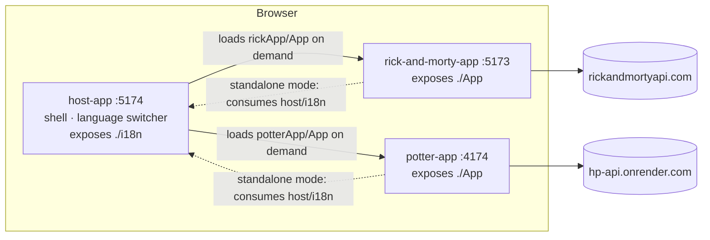

# Microfrontends with Module Federation (React + Vite)

[](https://github.com/AleVzT/microfrontend-challenge/actions/workflows/ci.yml)

A host application that composes two independently built React microfrontends at runtime using **Module Federation**. The host owns the shell and the shared internationalization (i18n) instance; each remote owns its own data fetching and UI.

> **Context.** Originally built in 2025 as a time-boxed technical assessment for a frontend role. It was later revised to fix build and lint issues, update vulnerable dependencies, add tests and CI, and document the architecture. The original scope and architecture were kept on purpose.

## Architecture



| App | Role | Exposes | Consumes |
|---|---|---|---|
| `host-app` | Shell: header, remote selector, language switcher, remote loading and error states | `./i18n` | `rickApp/App`, `potterApp/App` |
| `rick-and-morty-app` | Remote: Rick and Morty character list | `./App` | `host/i18n` (standalone mode only) |
| `potter-app` | Remote: Harry Potter character list | `./App` | `host/i18n` (standalone mode only) |

### Key technical decisions

- **Runtime composition, independent builds.** Each app has its own `package.json`, lockfile and build, so it can be versioned and deployed on its own. The root scripts orchestrate them without merging them into a single dependency tree.
- **One i18n instance, owned by the host.** The host exposes its configured `i18next` instance. Because `react`, `react-dom`, `react-i18next`, `i18next` and `styled-components` are declared as shared dependencies, the remotes render with the host's React and translation context. Switching the language in the host updates the content of the mounted remote without extra wiring.
- **Lazy loading of remotes.** A remote is fetched only when the user selects it. `RemoteContainer` isolates that concern: it shows a loading state, renders the remote's default export, and shows a translated error if the remote cannot be loaded (network failure, remote down, missing export).
- **Remotes own their data.** Each remote fetches from its public API through a custom hook (`useCharacters`). Presentational components (`CharacterCard`, `CharactersPage`) stay free of data-fetching logic and are tested in isolation.
- **Scoped styling.** `styled-components` keeps component styles encapsulated per microfrontend.
- **Deployment-ready configuration.** Remote URLs default to the local ports and can be overridden at build time with environment variables (see [Configuration](#configuration)). Ports are fixed (`strictPort`) because federation depends on exact URLs.

## Getting started

Requirements: Node.js 20.19+, 22.12+ or 24+ (see `.nvmrc`).

```bash
npm run setup   # installs each app from its own lockfile (npm ci)
npm start       # builds all three apps and serves them together
```

Then open **http://localhost:5174**.

Remotes are served from their production build (`vite preview`) because `@originjs/vite-plugin-federation` only generates `remoteEntry.js` at build time. The host can also run in dev mode (`npm run dev` inside `host-app`) while the remotes are being served.

### Scripts (repository root)

| Command | Description |
|---|---|
| `npm run setup` | `npm ci` in every app |
| `npm start` | Build every app, then serve all three (Ctrl+C stops them all) |
| `npm run lint` | ESLint in every app |
| `npm test` | Vitest (single run) in every app |
| `npm run build` | Type-check (app + tests) and build every app |
| `npm run verify` | Lint, test and build: the same checks CI runs |

Each app also keeps its own `dev`, `build`, `preview`, `lint`, `test` (watch mode) and `test:ci` scripts.

## Configuration

Remote URLs are resolved at build time. Copy `.env.example` to `.env` in an app to override the defaults, or set the variables in the build environment:

| App | Variable | Default |
|---|---|---|
| `host-app` | `VITE_RICK_REMOTE_URL` | `http://localhost:5173/assets/remoteEntry.js` |
| `host-app` | `VITE_POTTER_REMOTE_URL` | `http://localhost:4174/assets/remoteEntry.js` |
| remotes | `VITE_HOST_REMOTE_URL` | `http://localhost:5174/assets/remoteEntry.js` |

These values are public URLs, not secrets. `.env` files are git-ignored.

## Quality

- **Tests:** 25 tests across the three apps (Vitest + Testing Library). They cover data hooks (success, HTTP error, network error), presentational components (rendering, image fallback, house badges) and host behavior (remote loading, remote failure, language switching). Federated imports are replaced by per-remote test doubles (`host-app/vitest.config.ts`).
- **Type safety:** `tsc -b` type-checks application code and test code in separate TypeScript projects, so test-only globals do not leak into production code.
- **CI:** GitHub Actions runs `npm ci`, lint, tests, build and `npm audit --omit=dev --audit-level=high` for each app on every push and pull request.
- **Dependencies:** runtime dependencies have no known vulnerabilities at the time of the last revision. Dependabot is configured for monthly grouped updates.

## Known limitations

These are deliberate trade-offs or open items. They are documented here instead of being hidden:

- **Federation plugin.** The project uses the community plugin `@originjs/vite-plugin-federation`, so remotes must be built to be consumed. A natural evolution would be the official `@module-federation/vite` plugin (runtime manifests, dev-mode remotes, typed remotes). It was not migrated, to keep the original scope.
- **Two-way coupling for i18n.** The remotes import `host/i18n` when they run standalone, so the host must be running to use a remote on its own. A shared i18n package or a remote-owned fallback would remove that dependency.
- **Build-time remote URLs.** Remote locations are baked into the host build. Switching versions or environments at runtime would need a manifest or a runtime remote registry.
- **Static remote list.** The plugin needs static import specifiers, so the available remotes are listed in `RemoteContainer`.
- **Error handling scope.** Load-time failures of a remote are handled. Render-time errors inside a remote are not isolated by an error boundary yet.
- **External APIs.** Data comes from public community APIs. The Harry Potter API is hosted on a free tier and can be temporarily unavailable; the remote then shows its error state. Only the first 20 characters are shown (no pagination).
- **Unminified builds.** `minify: false` is kept from the original setup to keep the federated output readable. Enable minification for a real production deployment.
- **No public demo yet.**

## Project structure

```
.
├── host-app/             # Shell + shared i18n (exposes ./i18n)
├── rick-and-morty-app/   # Remote (exposes ./App)
├── potter-app/           # Remote (exposes ./App)
├── scripts/workspace.mjs # Zero-dependency orchestration for the root scripts
└── .github/              # CI workflow and Dependabot configuration
```

## Author

Designed and implemented by [Alexandro Garcia](https://github.com/AleVzT).

Character data is provided by [The Rick and Morty API](https://rickandmortyapi.com/) and [HP-API](https://hp-api.onrender.com/). This project is not affiliated with the owners of those franchises.
